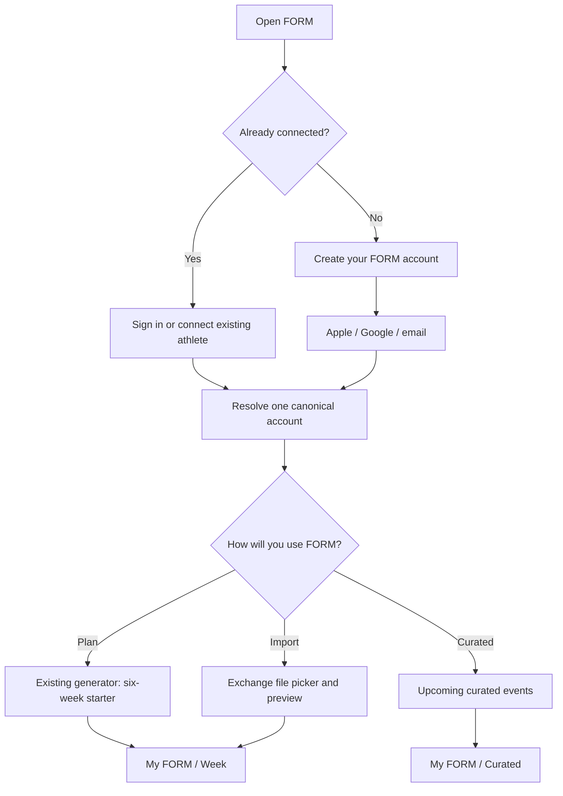

# FORM · The training and practice house

**Master product brief · October 26, 2026**  
Owner: Brice / Speed & Form  
Status: product decisions and engineering roadmap. A draft PR or migration is not a shipped feature.

## The proposition

FORM helps people train deliberately and find good company for the work. It can hold a carefully coached program, organize an athlete's own plan, or simply show where FORM's curated practice meets this week. None of those relationships requires the others.

FORM is the logistician. An athlete does not have to adopt FORM as their run coach to attend Thursday track, meet a long-run group, come to Muscle Beach, or join a yoga or ALO event. A committed FORM-coached athlete receives a much deeper relationship with a real coach. Free access should show the quality of that thinking, not create artificial dependency.

**October 26 concierge extension:** Brice's full arrival, progressive intake, live member poster and phone-only Coach-tab Arrivals / This morning / Plans to arrange / The week ahead are defined in `docs/product/FORM_ARRIVAL_CONCIERGE_IMPLEMENTATION_CONTRACT_20261026.md`. The three doors and training city remain. The approved experience is staged engineering work, not proof of configured Google/email-code auth, actual plan activation, or personally staffed 24-hour support. Build the 44.3 native integration on the verified 44.2 release base; do not merge older native Curated #117 as a whole-file replacement.

## First product milestone: 100 real, claimed accounts

**Goal: 100 distinct people who have actually connected or created verified FORM accounts and used one of the product lanes.** This is not 100 app installs, 100 raw email addresses, 100 coach-roster entries or 100 paid clients.

Count a person as **claimed** only when their verified Supabase account resolves to one canonical FORM member identity (existing invitation or self-created). Count an **activated member** only after a durable first useful action: opening a real Week, activating their own validated plan, or viewing/RSVPing to a dated Curated event. Count **retained use** separately as another meaningful visit/action in a later week. A passive push-open or background refresh should not qualify.

The first private operator dashboard needs four distinct numbers, with day/week cohorts rather than personal surveillance: verified accounts, resolved/claimed members, activated members, and next-week returning members. Report entry lane, invitation/claim failure, time to first useful action, missing-plan error, import validation/publish failures, event RSVP and event cancellation handling. Make QA test accounts identifiable and exclude them. Avoid broad behavioral tracking, public leaderboards, location trails and third-party advertising identity sharing. Preserve anonymous aggregate reporting when users request deletion.

At 100, conduct a structured design and coaching review: which paths are genuinely used, whether external-coached athletes benefit without switching systems, how often Curated becomes real attendance, where athletes abandon onboarding, coach-operator hours per 25 members, and which features create voluntary conversations about paid coaching. Scale the first release for 100; model pagination, idempotency and owner boundaries toward 1,000 without premature social-network complexity.

## The three independent entry paths

| Entrance | Who it serves | First useful screen | Training owner |
| --- | --- | --- | --- |
| **Make a plan** | Runner who wants FORM to give them structure | The first Week of a six-week starting block | Athlete. FORM-generated starter, not Brice-coached |
| **Bring a plan** | Runner with their own coach, ChatGPT, Claude or other system | Import preview, then their own Week | Athlete or stated external source. Never impersonate Brice |
| **Join the practice** | Person who wants track, runs, fitness, yoga, strength, socials | FORM Curated upcoming events | No training plan needed |

There is no hierarchy of worth among these people. From the Dossier, members may add a plan, switch active plan, browse Curated, connect Strava, or request coaching later. A participant like Ryan K may stay Curated-only forever. An externally coached runner like Adrian may never replace their current platform. Multiple lanes may coexist, but only one active training Week is resolved at a time.

## First launch and identity

An invitation is an entitlement-claim path on the **same Supabase identity**, not a separate account type. Apple, Google, and verified email are alternate credentials for that identity. Existing coaching access takes precedence and must not be overwritten by the self-service journey. Use provider linking and verified ownership to avoid duplicate accounts; never match identities solely on names or an unverified email.

### Progressive intake

Ask only what the selected experience needs now, then invite deeper information when it becomes useful:

1. **All members:** first name or preferred name, unit preference, entry path, optional broad training city/area, privacy and notification choices. Get email from the verified auth identity, not a typed duplicate field. Portrait and Strava are optional.
2. **Plan generator:** purpose (race or consistency), event/date if applicable, current weekly running, recent long run, available days, days protected from running, preferred quality days and time availability. The existing generator already has many of these inputs. Ask about injury/medical constraints privately only as warranted by that feature, not as an event-access condition.
3. **Plan import:** unit preference and file selection only. An athlete can skip the generator entirely. Never quietly infer training history from a name, location, Strava or another athlete.
4. **Curated:** current city/area and optional event interests. Never require weekly mileage, a race goal or a plan.
5. **Training Together later:** a distinct, off-by-default consent for approximate city/area and training-company preferences. No GPS or home address. This is not consent to reveal a plan.

Record coaching interest as a voluntary expression of interest, not automatic marketing consent, sales qualification or a coach-roster assignment.

## Starter plan and Plan Exchange

The six-week starter is the suggested first result from FORM's existing running plan maker. It is **not a six-week storage limit, expiring entitlement or general restriction**. The athlete may return for further starter work, upload 12 or 20 weeks, or use Curated alone without payment. An honest free sample is an invitation to FORM's method. No automatic $500/month billing and no artificial expiry.

The generator owns running-day selection and training load; it must not prescribe a hard session on a protected day or double up hard sessions to satisfy a count. It should distinguish a recent runner from a new runner before prescribing intensity. The existing half-marathon-specific race engine must not be marketed as a validated 5K, 10K or marathon generator without those programs actually existing. Quality days and duration should be adjustable without manufacturing physiologic thresholds.

Exchange uses **the existing schema-1 JSON contract** in `private/plan-import-standard.mjs` and `docs/coaching/FORM_PLAN_EXCHANGE_100_ATHLETE_CONTRACT_20261025.md`:

- Export active plan or download a clean starting file from the website at `/plans/exchange/`.
- Edit it with ChatGPT, Claude or another assistant, with explicit units, dates, session blocks, repeats and rest.
- Import as a private draft; show what changes before activation.
- Confirm to activate a versioned personal plan; preserve previous active plan, completed runs, calendar events and coach-authored provenance.
- Self-service plans never silently enter Brice's coached roster or overwrite an actual coached prescription.

The website's downloadable example is a **file starter, not a second coaching engine**. It does not assign identity, claim a plan has been published, or transmit personal data. Client-side preview alone does not meet the trusted server import acceptance standard.

## The plan-free Week

An authenticated member without an active plan must see an intentional state, never a broken or ghost Week:

- **Curated-only:** opening home shows the next actual dated event and upcoming calendar; My FORM retains the Dossier and a clear `Add a training plan` action. Do not render seven fabricated rest days.
- **Plan chosen, not yet imported:** show `Your Week is ready when your file is`, with `Import your plan` and `Make a starter plan` actions.
- **Plan loading/error:** distinguish a temporary failure from a verified no-plan state. Never imply the user has no plan when the feed failed.
- **Coached member:** the coach's real published Week, including protected session details and correct plan provenance. A Curated RSVP appears in addition to it, not instead of it.

An event and a session are different records. An athlete might attend a 3-mile ALO event and complete more of their independent prescribed run afterward. The event itself is not a completed training receipt or a coach-reviewed workout.

## FORM Curated · the Miami starting scope

Three Brice-managed editorial profiles: **FORM**, **iRUN Monday**, and **ALO Wellness**. These are FORM's curated references, not a claim that iRUN or ALO has signed up, authorized a partner account or maintains a live synchronized schedule. Later curated entries may include Muscle Beach strength, yoga, socials and specific hosted Saturday runs. Saturday *training* is not by itself a Saturday *meetup*.

- A dated, confirmed occurrence comes from a real event record. No fabricated recurring ALO dates.
- Athlete receives a My FORM invitation; unread circle on Week; invite entrance into Dossier; Upcoming Events list; calendar add to Apple/Google when complete time/place are confirmed.
- Join/decline is a participation intent, not an alteration to the plan. Show who else is going only according to each person's event visibility choice.
- Coach selects whom to invite, can see RSVP and update/cancel event. Cancelations/moved times must update athlete view and reminder delivery.
- Public discovery and private invited occurrences are separately authorized.

Future paid events/classes may use paid reservations, capacity, refund and cancellation terms, but that is not the first release. There is no marketplace and no RunCards ingestion now.

## FORM Training Together · Phase 2

Private opt-in, first-party matchmaking begins as a **coach-side tool**. The staged Phase 2 backend models approximate self-declared training area, training-company requests, and two-party acceptance mediated by FORM. Athletes cannot search each other's full plans or use an unrestricted public DM network. A future suggestion card can say `FORM found someone doing a similar long run Saturday` without disclosing the other athlete's health, full plan, unreviewed pace or precise location.

The coach checks time, distance, ability and the nature of the session before proposing a pairing. Both people agree before FORM connects them. Opting out closes the path. The existing Phase 2 draft #377 is **not live**; its current identity precondition requires a linked athlete membership, so the open member journey will eventually need a separate consented bridge before a Curated-only member can enter matching.

## Identity, data ownership and authorization

| Data | Canonical owner | Boundary |
| --- | --- | --- |
| Login / verified email / linked providers | Supabase Auth | One account, no second Forge login |
| Basic self-service entry choices | New account-scoped journey record | Owner read/write only; not a coach roster |
| Public person / gallery identity | Existing `collective_people` and permissions | Never auto-publish an athlete |
| Brice-coached athlete and Week | `athletes`, `athlete_memberships`, `training_blocks`, `planned_sessions` | Explicit coached relationship only |
| Self-authored/imported plan | Private versioned personal plan/import service | Owner-scoped, explicit active plan selector |
| Curated host/event/invite | Phase 1 Curated migration and Collective occurrence | Event overlay, never training replacement |
| Match consent and introductions | Phase 2 Training Together migration | Private and coach mediated |

Do not write guessed names/locations, Strava credentials, private file content or external coach data into public profiles. Restrict the authenticated user's file fetches and server import receiver by authorization; a schema-valid JSON file alone never authorizes publication. Coach previews never leak another member's private personal plan by default.

## Pricing / relationship

The product can be useful forever for free: event calendar, private training organization, basic starter plans, and bring-your-own-plan. Brice's **high-touch coaching service** is the premium human operation: programming, calibration, movement analysis, scheduled reviews, coordinated race/build decisions, long-run company and connection management. The working $500/month concept is a positioning hypothesis until offer details, capacity, terms and payment flow are approved; don't render it as a product checkout or promise it in onboarding yet.

## Current capability audit (October 26)

| Capability | Observed state | Work remaining |
| --- | --- | --- |
| Auth | Supabase Apple/email linking + coach-invite paths exist; no general public account sign-up proved live. Collective member handling is present but its ship flag is off. | Apple/Google/email create-account entrance; provider linking and two-account QA |
| Runner plan creation | `FORMStrangerOnboardingFlow` has race/fitness intake, runs/week, available days, weekly mileage and a real `formGenerateWeekPlans` seam. Race choice is currently half-marathon-only. | Separate account creation from plan creation; protected/hard day controls; six-week starter adapter and explicit origin |
| Plan Exchange | Schema-1 parser/tests in web repo. Native Paper Spine Exchange entrance is informational in PR #99. | Signed-in receiver, draft/preview/commit, rollback, native importer and empty Week |
| Curated | Existing Collective events and community code; Phase 1 curated coach/site and native drafts #376/#117. | Signed-in, two-account, phone acceptance; production rollout not yet authorized |
| Training Together | Private matching schema and coach RPCs staged in #377. | Full migration rehearsal, identity bridge, coach queue UI, consent/reply UI, negative RLS tests |
| Profiles / roster | Separate collective member, public person and coached athlete identities exist. | Non-coached member route, no roster pollution, profile options and discoverability consent |
| Notifications | Collective and FORM Miami message/notification infrastructure exists. | One deduplicated member notification policy across invites, changes, matches, quiet hours |
| Website | `/plans/`, `/form/`, and library exist; import schema and sample exist privately in repository. | Public downloadable schema-1 starter plus clear app handoff |

## Implementation and release sequence

1. **Open account foundation.** Stage account journey table and typed owner-only fields; choose Apple, Google, email and existing-invite resolver. Wire modes without auto-creating coaching grants.
2. **Website file front door.** Give people a valid downloadable starter, import contract and a simple AI-editing instruction; link from Plans shelf. No fake upload service.
3. **Native entry + zero-plan state.** Finish sign-up credentials, preview/selection, Curated-only default and real plan-independent Dossier. Unit/voice/accessibility acceptance.
4. **Personal plan intake.** Adapt existing generator to a six-week starting window, protect days, implement validated versioned import and actual active Week routing.
5. **Curated release.** Finish Phase 1 server/native QA and publish as one deliberate batch, not per edit.
6. **Matchmaking pilot.** Apply Phase 2 only after Phase 1; test with opt-in synthetic or consented athlete accounts, coach queue and two-sided approvals.
7. **Growth and premium service.** Observe which entry path members choose, event repeats, import activation, voluntary coaching inquiries, and support load. Do not collect a public engagement leaderboard.

**Hard release gates:** stage/migrate with version history; negative RLS and auth tests for distinct users; plan import idempotency and rollback; actual signed-in athlete devices (small iPhone, light/dark, Dynamic Type); plan-free state; existing coached Week and filing regression; event calendar timezones and cancellations; privacy and deletion; Google/Apple email provider confirmation; no unreviewed athlete-targeted workout publication; owner-approved batch deployment and on-device readback.

## Product acceptance stories

- **Ryan K:** signs in, chooses `Join the practice`, sees FORM track and upcoming confirmed events. Never has to invent a race or training week.
- **Adrian:** keeps his existing running coach platform, joins curated Thursday, never sees a claim that Brice authored or replaced his coach's work.
- **A new runner:** creates a verified account, enters four available days and protected days, receives a transparent six-week FORM starter, then optionally edits/exports it with an AI assistant. No hard work is scheduled on a protected day.
- **A returning coached athlete:** connects the existing account; their real active current week remains intact. Signup never creates a duplicate athlete or resets the season.
- **A bring-your-own-plan runner:** downloads the file, edits it with Claude, previews import, activates it, and keeps their completed records and previous revision available.
- **Patrick and another marathoner:** FORM privately sees a potentially compatible long run and proposes an introduction. No one can search the other's private plan; both consent before a connection.

## Source references within the repos

- Native `FORM/Shell/FORMStrangerOnboardingFlow.swift`, `FORM/Collective/FORMCollectiveAccount.swift`, `FORM/Shell/FORMShipFeatureFlags.swift`, `FORM/Shell/FORMTrainingRouteStateView.swift`.
- Plan import `private/plan-import-standard.mjs` and `docs/coaching/FORM_PLAN_EXCHANGE_100_ATHLETE_CONTRACT_20261025.md`.
- Curated Phase 1: website PR #376 and native PR #117. Phase 2 matching: website PR #377.
- iOS plan/display integration: PR #99 (informational Exchange entry only). Verify against latest main before merging.
